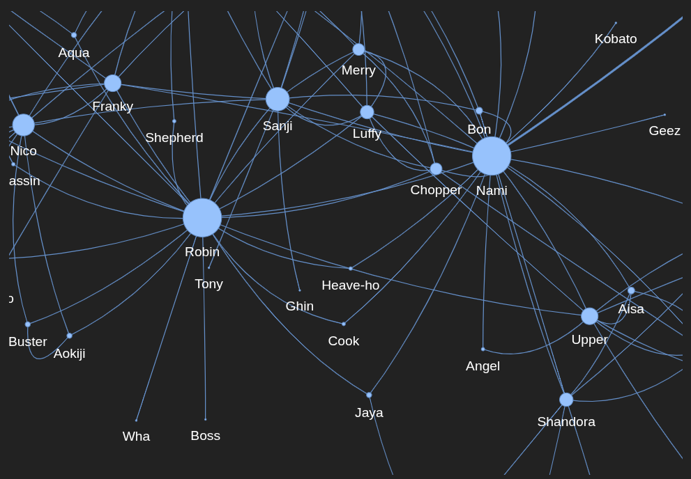

# One Piece Data Analysis


An exploratory analysis of One Piece Devil Fruit data and anime subtitles.
The notebook builds character co-occurrence networks and classifies episode
themes using a hosted zero-shot model.

## What the notebook does

[`notebooks/one_piece_analysis.ipynb`](./notebooks/one_piece_analysis.ipynb)
contains the project's end-to-end exploratory workflow:

1. **Devil Fruit data**
   - Scrapes Devil Fruit names and links from the One Piece Wiki.
   - Loads the retained raw Devil Fruit table, removes unused columns, fills
     missing values, and renames the meaning field.
   - Saves the cleaned table to `data/processed/devil_fruits_info.csv`.
   - The Wiki scrape is optional and depends on the website's current HTML
     structure.
2. **Subtitle preparation**
   - Reads the supplied `.ass` subtitle files from `data/raw/subtitles/` and
     combines dialogue into episode scripts.
   - Uses [`clean_episode_scripts`](./src/cleaning.py) before entity extraction
     to remove subtitle markup, escaped line breaks, standalone numbers,
     common Japanese honorifics, music-marked lines, and multi-line content
     repeated across episodes.
3. **Character extraction and relationships**
   - Uses spaCy's `en_core_web_sm` model to identify person entities, then
     records first-name forms by sentence.
   - Counts character co-occurrences within a rolling 10-sentence window,
     keeps the 200 most frequent connections, and builds a NetworkX graph.
   - Displays the relationships with a Matplotlib plot and an interactive
     PyVis network in the notebook.
   - Saves episode scripts and extracted entities to
     `data/processed/character_network.csv`.
4. **Episode theme classification**
   - Sends chunks of 20 sentences to Hugging Face Inference Providers using
     `facebook/bart-large-mnli`.
   - Estimates scores for themes such as friendship, hope, sacrifice, fighting,
     betrayal, dreams, sadness, anger, and evil, then averages scores across
     each episode's chunks.
   - The notebook demonstrates classification on one episode and applies it
     across the loaded scripts.

### Character network visualization



### Data and interpretation notes

- `data/raw/` contains the original Devil Fruit data, extra descriptions, and
  1,005 subtitle files. `data/processed/` contains the cleaned Devil Fruit
  table and a precomputed character-analysis CSV.
- The checked-in `character_network.csv` currently contains 200 episode rows;
  it is a partial saved result, not a processed copy of all 1,005 subtitle
  files. Running the subtitle extraction cells processes the available files.
- spaCy entity recognition is imperfect: it can mistake places or objects for
  people, miss names, and treat aliases or emphasized names as separate
  characters. The graph represents nearby name mentions, not confirmed
  interactions or dialogue speaker attribution.
- Zero-shot scores are estimates, not definitive labels. Remote classification
  requires network access and may be subject to provider limits or charges.

## Project layout

```text
.
├── data/
│   ├── raw/
│   │   ├── devil_fruits_info.csv
│   │   ├── extra_description.txt
│   │   └── subtitles/
│   └── processed/
│       ├── character_network.csv
│       └── devil_fruits_info.csv
├── notebooks/
│   └── one_piece_analysis.ipynb
├── src/
│   └── cleaning.py
├── tests/
│   └── test_cleaning.py
├── .gitignore
├── requirements.txt
└── README.md
```

## Setup

Create and activate a virtual environment, then install the dependencies:

```bash
python -m venv .venv
source .venv/bin/activate
python -m pip install -r requirements.txt
python -m spacy download en_core_web_sm
```

On Windows, activate with `.venv\Scripts\activate`.

Theme classification uses Hugging Face Inference Providers. Create a
Hugging Face token with Inference Providers access and set it as `HF_TOKEN`
before starting Jupyter. Keep the token out of the notebook and source control:

```bash
export HF_TOKEN="your_token"
jupyter lab
```

On Windows PowerShell, set it for the current terminal with:

```powershell
$env:HF_TOKEN = "your_token"
jupyter lab
```

Open the notebook and select the project's `.venv` Python kernel. Run cells in
order, starting with the data preparation cells. The analysis makes network
requests for Wiki scraping and hosted inference. Inference sends episode text
to the configured provider.

## Future ideas

- **Character relationships over time:** build per-episode or per-arc graphs
  and chart how characters' centrality and connections change.
- **Theme timeline:** visualize episode theme scores across the series or
  story arcs, after checking predictions on a sample by hand.
- **Character dialogue profiles:** analyze words and themes associated with
  characters; reliable speaker attribution would require additional work.
- **Devil Fruit explorer:** create a searchable page or dashboard for fruit
  names, descriptions, meanings, and categories.
- **Catchphrase analysis:** find recurring phrases while separating songs,
  previews, and series-wide narration from character-specific phrases.
- **Interactive dashboard:** combine an episode selector, cleaned script,
  theme scores, and character network in a small app.
